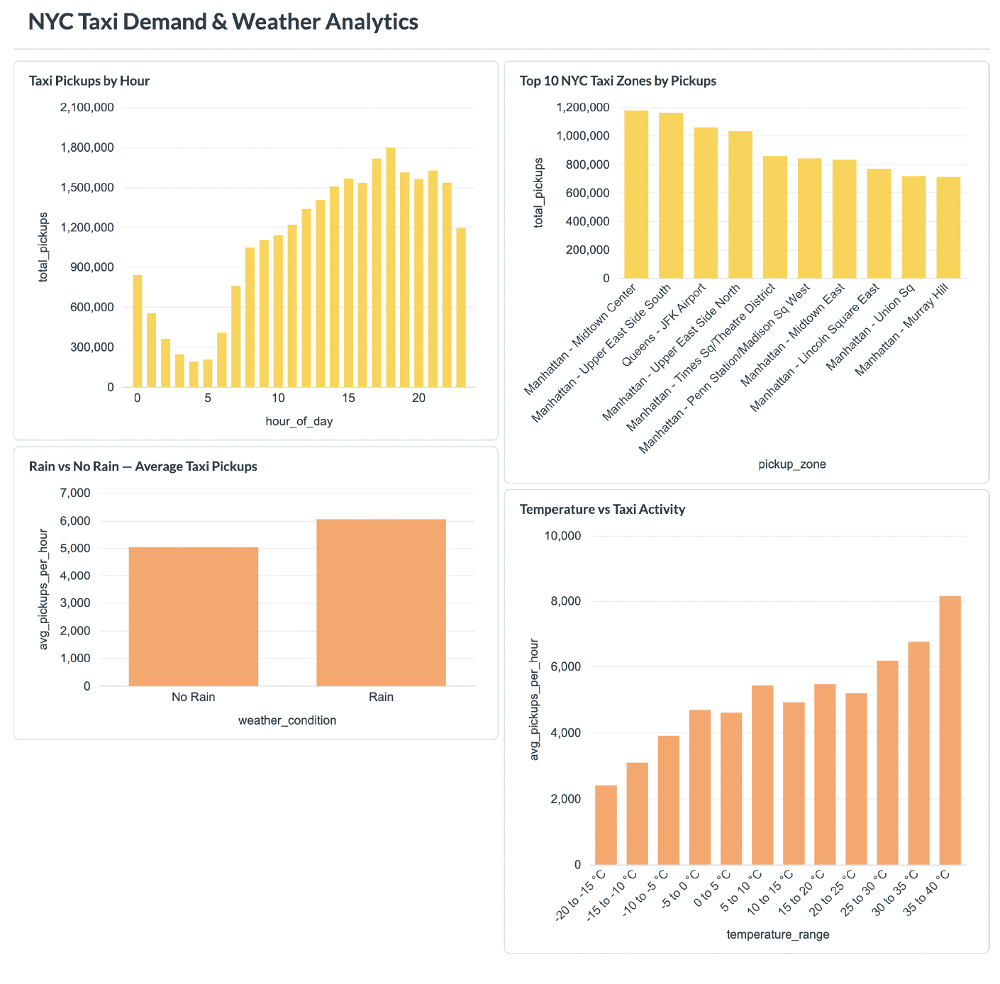

# # UrbanFlow — NYC Taxi & Weather Analytics


An end-to-end data engineering project that processes New York City Yellow Taxi trip records and historical weather data to analyze taxi activity across locations, hours, and weather conditions.

The project combines **Apache Airflow, Python, DuckDB, dbt, Docker, and Metabase** into an automated ELT pipeline.

## Business Problem

How does observed NYC taxi activity vary across pickup locations, times of day, and weather conditions?

The project explores:

- Which NYC taxi zones have the highest recorded pickup activity?
- What hours have the most taxi trips?
- How does observed taxi activity differ between rainy and non-rainy hours?
- How does temperature relate to taxi activity?

**Important limitation:** Completed taxi trips measure observed activity, not unmet demand or taxi availability. Weather measurements from a representative NYC location are also a proxy rather than exact conditions for every pickup zone.

## Technology Stack

| Technology | Purpose |
|---|---|
| Python | Data ingestion and validation |
| Apache Airflow 2.10.5 | Pipeline orchestration |
| Docker Compose | Containerized services |
| DuckDB | Analytical data warehouse |
| dbt | SQL transformations and automated tests |
| Open-Meteo | Historical weather data |
| NYC TLC | Yellow Taxi trip records |
| Metabase | Interactive analytics dashboard |

## Architecture

```text
NYC TLC Parquet       Open-Meteo API
       |                    |
       v                    v
   Python Ingestion & Validation
                |
                v
        DuckDB Raw Layer
                |
                v
         dbt Staging Layer
                |
                v
         dbt Analytical Marts
                |
                v
        BI DuckDB Snapshot
                |
                v
         Metabase Dashboard
```

Apache Airflow orchestrates the entire workflow.

## Airflow Pipeline

The DAG is named `nyc_taxi_pipeline` and contains nine tasks:

1. `prepare_period` — Select the processing period, including historical backfill.
2. `has_work` — Skip downstream processing if no incomplete period is found.
3. `download_taxi` — Download and validate TLC Parquet files.
4. `ingest_taxi_batch` — Load trip records into DuckDB.
5. `ingest_zones` — Load NYC taxi zone reference data.
6. `refresh_weather` — Retrieve or reuse historical weather data.
7. `validate_weather` — Check weather completeness before transformation.
8. `dbt_build` — Build analytical models and execute tests.
9. `export_metabase` — Export a compatible DuckDB snapshot for Metabase.

The DAG supports both explicit processing periods and automatic selection of incomplete historical months.

## Data Modeling

### Raw Layer

Stores source taxi trips, taxi zone reference data, historical weather observations, and weather refresh status.

### Staging Layer

`stg_trips` performs data preparation and identifies records that satisfy the project's usability rules.

### Analytical Marts

**`fct_trips_hourly`**

Aggregates valid taxi trips by pickup hour and pickup zone.

**`fct_taxi_weather_hourly`**

Combines hourly taxi activity with historical weather observations.

## Data Quality

The pipeline includes:

- Source-to-target row-count reconciliation.
- Checks for missing weather observations.
- dbt uniqueness tests.
- Validity checks for trip records.
- Trip-count reconciliation between analytical models.
- Controlled reprocessing of incomplete months.

A dedicated weather validation task prevents downstream dbt processing when required weather data is incomplete.

## Reliability and Fault Tolerance

The project implements several reliability mechanisms:

**Idempotent ingestion:** Reprocessing the same month replaces its records rather than accumulating duplicates.

**Historical backfill:** The pipeline identifies the earliest incomplete month for processing.

**Weather caching:** Previously retrieved weather observations can be reused when API requests fail.

**Controlled missing-source handling:** When a requested TLC file is not yet published, the pipeline can skip dependent tasks and retry during a future scheduled run.

**Atomic BI snapshot replacement:** The Metabase export is prepared separately before replacing the published database file.

## Analytics Dashboard

The Metabase dashboard includes four visualizations:

1. Taxi Pickups by Hour
2. Top 10 NYC Taxi Zones by Pickups
3. Rain vs No Rain — Average Taxi Pickups
4. Temperature vs Taxi Activity

The dashboard is designed for exploratory analysis. Observed weather relationships are correlations and should not be interpreted as causal effects.

## Data Sources

- [NYC TLC Trip Record Data](https://www.nyc.gov/site/tlc/about/tlc-trip-record-data.page)
- [Open-Meteo Historical Weather API](https://open-meteo.com/en/docs/historical-weather-api)

## Development Environment

The project was developed locally using macOS, Python, Docker Desktop, Apache Airflow, DuckDB, dbt, and Metabase.

Raw trip files, local databases, environment variables, and generated artifacts are excluded from version control.

## Project Status

The ingestion, modeling, orchestration, quality-control, and dashboard components have been implemented and exercised locally.

The automated DAG schedule is configured. Its first scheduled execution and complete reproducibility from a clean environment require final verification.

## Future Improvements

- Automatic monitoring and alerting.
- More granular weather data by geographic region.
- Incremental dbt models for large datasets.
- Continuous integration for SQL and Python tests.
- Deployment to an always-on environment.

## Pipeline & Dashboard

### Apache Airflow Orchestration

The pipeline orchestrates data ingestion, historical
backfill, weather validation, dbt transformations,
data quality tests, and BI exports.


### Metabase Analytics Dashboard

UrbanFlow provides interactive visualizations
of NYC taxi activity by hour, pickup location,
rainfall, and temperature.


