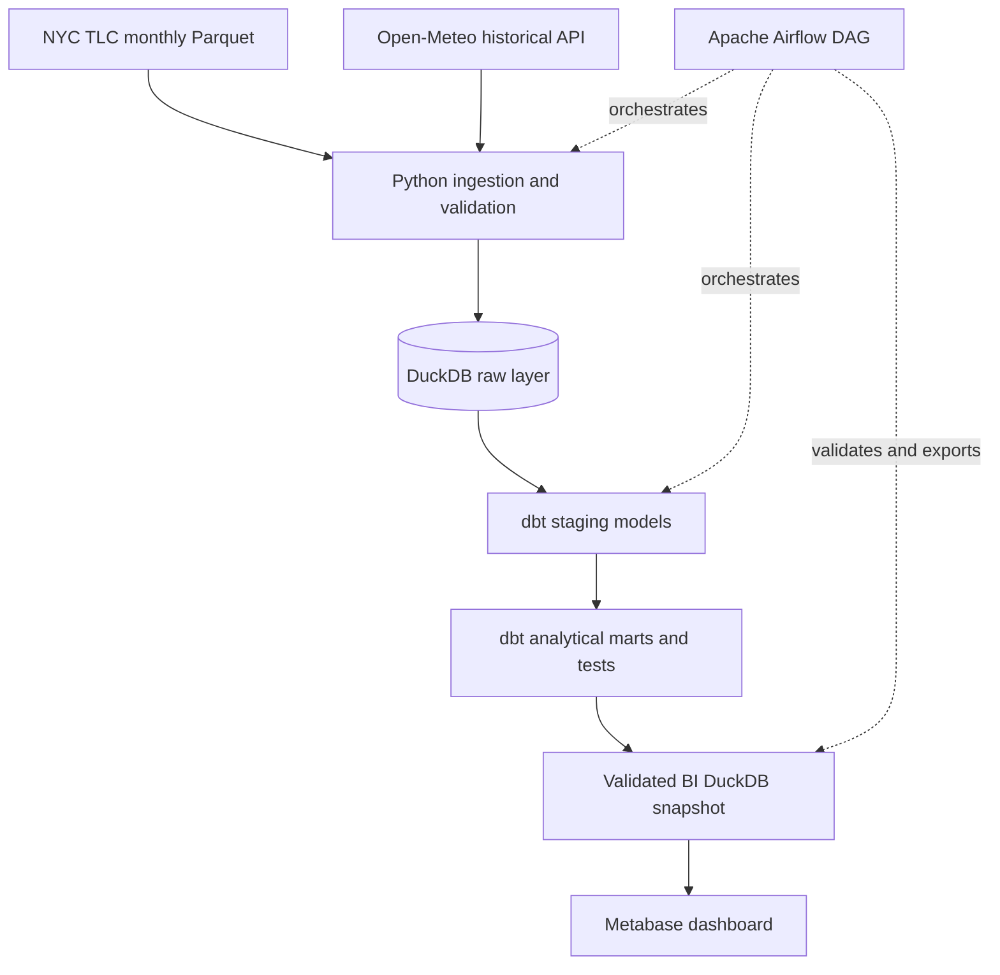
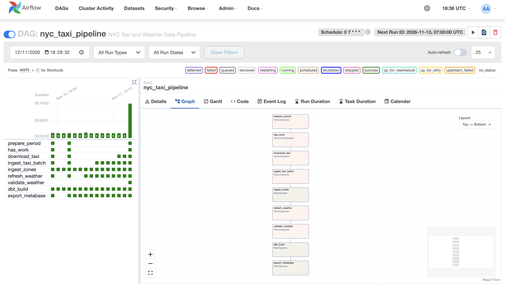

# UrbanFlow — NYC Taxi & Weather Analytics


**UrbanFlow** is an end-to-end data engineering and analytics project that combines New York City Yellow Taxi trip records with historical weather observations. It uses automated ingestion, a DuckDB analytical warehouse, dbt transformations and quality checks, Apache Airflow orchestration, and a Metabase dashboard.

> **Scope:** This project analyzes **recorded taxi trips**, not unmet passenger demand or the availability of empty taxis. Its weather series represents one NYC location and should not be interpreted as exact weather conditions for every taxi zone. The dashboard reports associations, not causal effects.

## What the project answers

- Which NYC taxi zones have the most recorded pickups?
- How do pickup counts vary by hour?
- How does observed activity compare between rainy and non-rainy hours?
- What patterns appear across temperature ranges?

## Technology stack

| Technology | Role |
| --- | --- |
| Python | TLC file downloading, API ingestion, validation, and exports |
| Apache Airflow 2.10.5 | DAG orchestration, scheduling, and historical backfill |
| Docker Compose | Containerized local infrastructure |
| DuckDB | File-based analytical warehouse |
| dbt-core + dbt-duckdb | SQL staging, marts, and data tests |
| NYC TLC | Monthly Yellow Taxi Parquet files and taxi-zone reference data |
| Open-Meteo | Hourly historical weather data |
| Metabase | Exploratory dashboard and saved visualizations |

## Architecture



The warehouse stores taxi trips, taxi zones, weather observations, and weather-refresh status. Trip records are aggregated by pickup hour and zone. The taxi/weather mart joins the hourly aggregates to weather observations, accounting for New York's local timezone.

## Airflow pipeline

The `nyc_taxi_pipeline` DAG contains nine tasks, executed in this order:

| Task | Responsibility |
| --- | --- |
| `prepare_period` | Choose an explicit date range or the earliest incomplete historical month |
| `has_work` | Skip downstream processing when no eligible incomplete month remains |
| `download_taxi` | Download and validate monthly TLC Parquet data |
| `ingest_taxi_batch` | Load or replace the selected month's raw taxi records |
| `ingest_zones` | Load taxi-zone reference data |
| `refresh_weather` | Fetch or reuse historical weather observations |
| `validate_weather` | Stop downstream processing if required hourly weather coverage is incomplete |
| `dbt_build` | Build staging/mart models and run dbt data tests |
| `export_metabase` | Export a DuckDB snapshot compatible with the Metabase DuckDB driver |

The local Airflow DAG is configured for **07:00 UTC daily**. Scheduled DAG runs were observed to complete successfully on **November 11 and 12, 2026**. Scheduled execution requires Docker Desktop and the relevant containers to be running; this is **not an always-on cloud deployment**.

The pipeline selects an incomplete month for backfill; it does not process every missing month in one run. A manual run may specify a period explicitly, for example:

```bash
docker compose exec airflow-scheduler \
  airflow dags trigger \
  --conf '{"start_month":"2025-04","end_month":"2025-04"}' \
  nyc_taxi_pipeline
```

## Data modeling

- **Raw layer:** `raw.yellow_trips`, `raw.taxi_zones`, hourly weather, and refresh status.
- **Staging:** `stg_trips` flags records according to explicit trip-validity criteria.
- **Mart:** `fct_trips_hourly` aggregates usable trips by pickup hour and pickup zone.
- **Mart:** `fct_taxi_weather_hourly` adds hourly weather attributes for analysis.

Completed taxi trips are the observational unit; `trip_count` is not a measure of unserved demand. The single-location weather series is a geographic approximation for NYC pickup zones.

## Data quality and reliability

- **Idempotent monthly ingestion:** Reprocessing a month replaces its rows rather than appending duplicates.
- **Source-to-target reconciliation:** Parquet row counts are compared with loaded monthly rows when selecting backfill work.
- **Historical coverage:** The next incomplete month is selected by examining taxi data and weather coverage.
- **Weather quality gate:** An explicit check blocks dbt and BI export when weather for the selected period is incomplete.
- **dbt tests:** Automated checks cover uniqueness, trip validity, and reconciliation between models.
- **Weather caching and failure handling:** Previously cached observations can be reused; refresh status records API failures or successful fetches.
- **Missing-source handling:** An unavailable TLC monthly file can be skipped and checked again during a later scheduled run.
- **BI export:** A separate DuckDB snapshot is built and replaced after validation for compatibility with Metabase.

These safeguards improve reliability but do not constitute a production SLA or guarantee that the public source data is error-free.

## Pipeline and dashboard

### Apache Airflow



### Metabase


The dashboard contains four saved analyses:

1. Taxi Pickups by Hour
2. Top 10 NYC Taxi Zones by Pickups
3. Rain vs No Rain — Average Taxi Pickups
4. Temperature vs Taxi Activity

Weather/activity comparisons are descriptive correlations. In particular, seasonal patterns, weekdays, holidays, and trip-location mix can confound the comparisons.

## Local development setup

### Prerequisites

- Docker Desktop with Docker Compose
- Git
- Enough available disk space for monthly TLC Parquet downloads and DuckDB datasets

### Prepare the repository

```bash
git clone https://github.com/Bereke3/urbanflow-nyc.git
cd urbanflow-nyc
cp .env.example .env
mkdir -p data/raw data/warehouse data/bi logs config plugins
docker volume create nyc-metabase-app-data
```

### Build and start local services

```bash
docker compose config --quiet
docker compose build
docker compose up airflow-init
docker compose up -d
docker compose ps
```

| Service | Local URL |
| --- | --- |
| Airflow | http://localhost:8080 |
| Metabase | http://localhost:3000 |

**Verification status:** Docker Compose configuration validation, Airflow image build, and the deployed local pipeline have been tested. A complete first-time installation with an empty warehouse and a fresh Metabase application database has **not yet been verified end to end**. Additional initial setup, including Metabase permissions and datasource/dashboard configuration, may be required.

The external Docker volume `nyc-metabase-app-data` holds the local Metabase application database. It is **not** included in this repository. A new installation does not include the author's saved Metabase dashboard or historical data. The `data/raw`, `data/warehouse`, and `data/bi` folders are also local and excluded from Git.

**Do not use `docker compose down -v` to reset an existing deployment without a backup**; it can remove persistent volumes used by other services.

### Check the pipeline

After the stack is initialized and the DAG is available:

```bash
docker compose exec airflow-scheduler \
  airflow dags list-import-errors

docker compose exec airflow-scheduler \
  airflow dags list-runs -d nyc_taxi_pipeline
```

Review task logs in Airflow for the selected period. The first run may need to download several large public files or wait for API rate limits.

## Data sources

- [NYC TLC Trip Record Data](https://www.nyc.gov/site/tlc/about/tlc-trip-record-data.page)
- [Open-Meteo Historical Weather API](https://open-meteo.com/en/docs/historical-weather-api)

## Project status and limitations

**Verified locally:** Monthly taxi ingestion, historical weather ingestion, dbt modeling/tests, manual and scheduled Airflow runs, historical backfill selection, and Metabase visualization. The repository's Compose configuration and custom Airflow image build have also been checked from a clean Git clone.

**Not yet verified:** A full cold-start on a new machine with empty persistent storage and fully automated restoration of Metabase saved dashboards. This project runs on a developer machine, not a continuously available hosting platform.

Other limitations include single-location weather observations, a descriptive rather than causal analysis, and full dbt mart rebuilds rather than incremental dbt models.

## Possible next improvements

- Test and automate first-time provisioning, including Metabase dashboard setup.
- Add CI checks for Python, Compose, and dbt models.
- Pin the Metabase image by version or digest instead of `latest`.
- Add notifications and monitoring for scheduled-run failures.
- Implement incremental dbt models for larger historical datasets.
- Compare weather conditions using more geographically granular observations.
- Deploy the pipeline to an always-on environment.
